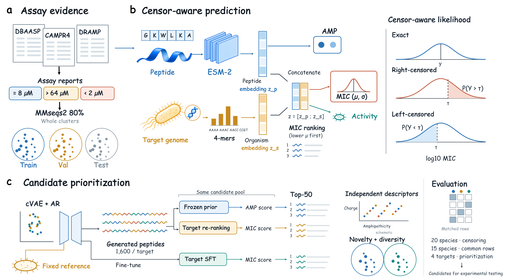

# AMPrioritizer

Censoring-aware modeling of threshold-reported MIC records for multi-species
antimicrobial peptide (AMP) prioritization.

This repository accompanies the article *"AMPrioritizer: Censoring-Aware Modeling of
Threshold-Reported MIC Records for Multi-species Antimicrobial Peptide Prioritization"*
(Bioinformatics). It provides the model, training code, processed benchmark data and
scoring tools.

<p align="center"></p>

## Overview

Published MIC records are frequently reported as inequalities (for example `>128 µM`).
Treating such thresholds as exact values biases regression and ranking. AMPrioritizer
fine-tunes the ESM-2 protein language model with a Tobit likelihood that handles exact,
right-censored and left-censored observations in a single objective, and conditions
predictions on a genome-derived organism representation so that one model serves many
target species.

Main components

- **Predictor** — ESM-2 (650M) encoder with an AMP head, a per-species activity head and a
  heteroscedastic Gaussian MIC head, trained with a censoring-aware likelihood and a
  ranking objective (`amp_prioritizer.model`, `amp_prioritizer.losses`).
- **Organism conditioning** — 340-dimensional genome 4-mer features encoded by an MLP and
  fused with the peptide representation (`amp_prioritizer.species_conditioning`,
  `amp_prioritizer.species_genome`).
- **Candidate generator** — conditional VAE with an autoregressive decoder for
  target-specific candidate generation (`amp_prioritizer.gen`).
- **Dataset** — a cluster-aware split of 68,421 peptides and 106,728 peptide–species MIC
  observation units with explicit censoring annotation (`data/`).

## Installation

Python 3.11 is required. A CUDA GPU is recommended for training and scoring.

```bash
git clone https://github.com/tsiolkovsky1024/AMPrioritizer.git
cd AMPrioritizer
conda env create -f environment.yml      # also installs mmseqs2 and cd-hit
conda activate amp-prioritizer
```

or, into an existing environment:

```bash
pip install -e ".[test]"
```

Verify the installation and the dataset:

```bash
amp-prioritizer data verify
pytest
```

## Data

The processed tables are in [`data/`](data/); see [`data/DATA.md`](data/DATA.md) for the
schema, counts, aggregation rules and provenance. Every file is listed with its SHA-256 in
`data/manifest.json`.

Training also needs the non-AMP negative set distributed with AMPlify, which is fetched
rather than bundled (GPL-3.0):

```bash
python scripts/fetch_negatives.py
python scripts/download_genomes.py        # optional: rebuild genome k-mer features
```

## Training

Two model families are provided. Reference configurations are in [`configs/`](configs/)
and summarised in [`docs/HYPERPARAMETERS.md`](docs/HYPERPARAMETERS.md).

```bash
# Compact predictor (AMP, species and MIC heads)
accelerate launch --num_processes 8 --mixed_precision fp16 \
    -m amp_prioritizer.train_stripped --config configs/benchmark.yaml

# Full multi-task predictor (adds physicochemical, hemolysis and selectivity terms)
accelerate launch --num_processes 8 --mixed_precision fp16 \
    -m amp_prioritizer.train --config configs/full.yaml --stage 2b
```

The configurations name `facebook/esm2_t33_650M_UR50D` as backbone, which is downloaded
from the Hugging Face Hub on first use. An optional masked-language-model adaptation
stage is available in `amp_prioritizer.mlm_pretrain` (`configs/stage0_mlm.yaml`).
Training the generator is described in [`docs/TRAINING.md`](docs/TRAINING.md).

Training was run on 8 × 32 GB GPUs; adjust `per_device_batch_size` and `grad_accum` to keep
the effective batch size when using different hardware.

## Scoring candidate peptides

```bash
amp-prioritizer score \
    --config configs/full.yaml --checkpoint runs/full/best.pt \
    --fasta candidates.fasta --out ranked.csv \
    --mode narrow \
    --target-species "Streptococcus pyogenes" \
    --offtarget-species "Escherichia coli" "Staphylococcus aureus"
```

`--mode classic` ranks by the product of the AMP probability and the target-species
activity probability; `--mode narrow` ranks by a narrow-spectrum score that additionally
accounts for the listed off-target species (see `amp_prioritizer/score.py`).

## Repository layout

```
configs/                reference training configurations
data/                   processed dataset, manifest and DATA.md
docs/                   hyperparameters and training notes
scripts/                scoring, genome download and data-fetch utilities
src/amp_prioritizer/    package: data, models, losses, training, generation
tests/                  unit and data-integrity tests
```

## Model weights

Trained checkpoints are not distributed with the repository. They can be requested by
opening an issue, and the configurations in this repository are sufficient to retrain the
models.

## Citation

If you use this work, please cite the article (see [`CITATION.cff`](CITATION.cff)).

## License

The source code is released under the [MIT License](LICENSE). The dataset in `data/` is
derived from third-party resources that are governed by their own terms; see
[`data/DATA.md`](data/DATA.md) before redistributing it.
